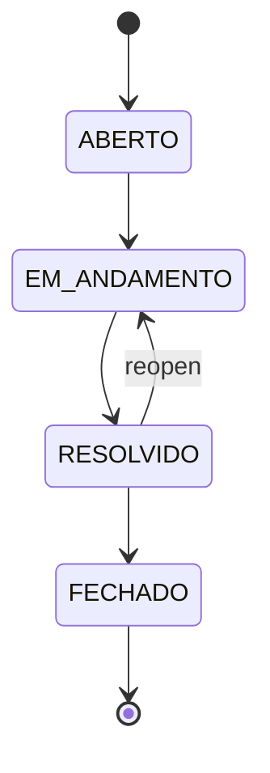

# SLA Ticket System

A REST API for managing support tickets with **SLA (Service Level Agreement) tracking**, built with Java 21 and Spring Boot.

Each ticket gets a resolution deadline based on its priority, follows a controlled status workflow, and can be flagged as overdue when the deadline is missed.


---

## Why this project

Support teams handle dozens of requests a day, and each one has a different level of urgency. Without clear deadlines and rules, critical issues get lost in the queue.

This API models that real-world problem: every ticket has a priority, every priority has a deadline, and the system enforces which status changes are allowed, so the ticket history stays consistent and auditable.

---

## Features

### Version 1.0 scope

- [x] Create, list, retrieve and update tickets
- [x] Priority levels that define the SLA deadline
- [x] Controlled status workflow (invalid transitions are rejected)
- [x] Standardized error responses with field-level validation messages
- [ ] Overdue ticket detection
- [ ] Comments and change history

### Planned for future versions

- Authentication and authorization (login)
- Front-end application
- Detailed reports
- Email notifications

---

## Business rules

### SLA by priority

The deadline (`prazoSla`) is calculated when the ticket is created: `creation time + SLA hours`.

| Priority (`prioridade`) | Meaning  | SLA      |
|-------------------------|----------|----------|
| `CRITICA`               | Critical | 4 hours  |
| `ALTA`                  | High     | 8 hours  |
| `MEDIA`                 | Medium   | 24 hours |
| `BAIXA`                 | Low      | 72 hours |

> SLA is currently measured in calendar hours. Business hours and holidays are on the roadmap.

### Status workflow



| Status (`status`) | Meaning     |
|-------------------|-------------|
| `ABERTO`          | Open        |
| `EM_ANDAMENTO`    | In progress |
| `RESOLVIDO`       | Resolved    |
| `FECHADO`         | Closed      |

Any transition outside this flow returns `409 Conflict`. When a ticket is resolved, the resolution time (`resolvidoEm`) is recorded; if it is reopened, that value is cleared.

---

## Tech stack

| Technology            | Purpose                                  |
|-----------------------|------------------------------------------|
| Java 21               | Language and runtime                     |
| Spring Boot 4         | Application framework                    |
| Spring Web MVC        | REST API                                 |
| Spring Data JPA       | Data access (Hibernate ORM)              |
| Bean Validation       | Request validation                       |
| H2 Database           | In-memory database for development       |
| Lombok                | Boilerplate reduction (getters/setters)  |
| Maven                 | Build and dependency management          |

---

## Getting started

### Prerequisites

- JDK 21
- Git

Maven does not need to be installed: the project ships with the Maven Wrapper (`mvnw`).

### Run locally

```bash
git clone https://github.com/YOUR-USERNAME/sistema-chamados-sla.git
cd sistema-chamados-sla

# Linux / macOS
./mvnw spring-boot:run

# Windows
mvnw.cmd spring-boot:run
```

The API will be available at `http://localhost:8080`.

The H2 console is available at `http://localhost:8080/h2-console` (JDBC URL: `jdbc:h2:mem:slaDb`).

> The database runs in memory, so data is reset every time the application restarts.

---

## API reference

| Method  | Endpoint               | Description               | Success |
|---------|------------------------|---------------------------|---------|
| `POST`  | `/tickets`             | Create a ticket           | `201`   |
| `GET`   | `/tickets`             | List all tickets          | `200`   |
| `GET`   | `/tickets/{id}`        | Get a ticket by ID        | `200`   |
| `PATCH` | `/tickets/{id}/status` | Change the ticket status  | `200`   |

### Create a ticket

**Request**

```http
POST /tickets
Content-Type: application/json

{
  "titulo": "Cannot access my email",
  "descricao": "Incorrect password error is shown",
  "solicitante": "Maria",
  "prioridade": "ALTA"
}
```

**Response** `201 Created`

```json
{
  "id": 1,
  "titulo": "Cannot access my email",
  "descricao": "Incorrect password error is shown",
  "status": "ABERTO",
  "prioridade": "ALTA",
  "solicitante": "Maria",
  "criadoEm": "2026-11-26T23:06:33",
  "prazoSla": "2026-11-27T07:06:33",
  "resolvidoEm": null
}
```

### Change the status

```http
PATCH /tickets/1/status
Content-Type: application/json

{
  "status": "EM_ANDAMENTO"
}
```

### Error responses

All errors follow the same format:

```json
{
  "status": 400,
  "mensagem": "Dados inválidos",
  "timestamp": "2026-11-27T10:15:00",
  "campos": {
    "titulo": "must not be blank"
  }
}
```

| Status | When it happens                                   |
|--------|---------------------------------------------------|
| `400`  | Missing or invalid fields, malformed request body |
| `404`  | Ticket not found                                  |
| `409`  | Status transition not allowed                     |

---

## Project structure

```
src/main/java/com/ticket/systemSLA
├── controller   # HTTP layer: receives requests, returns responses
├── service      # Business rules: SLA calculation, status transitions
├── repository   # Data access with Spring Data JPA
├── model        # JPA entities and enums
├── dto          # Request and response objects exposed by the API
└── exception    # Custom exceptions and global error handler
```

---

## Roadmap

- [ ] Overdue ticket endpoint and scheduled SLA check
- [ ] Comments and change history
- [ ] Pagination and filters (status, priority, assignee, period)
- [ ] Unit and integration tests (JUnit 5, Mockito)
- [ ] API documentation with Swagger / OpenAPI
- [ ] PostgreSQL with Flyway migrations
- [ ] Docker and docker-compose
- [ ] CI with GitHub Actions
- [ ] Business-hours SLA calculation
- [ ] Authentication, front-end, reports and email notifications

---

## Author

**Daniel Zan**
[LinkedIn](https://www.linkedin.com/in/daniel-de-assis-zan-09372a299/) 
